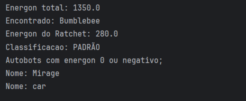

# Relatório – Sete erros encontrados no projeto Autobots

### Erro 1: Limite incorreto no laço de repetição

**Onde:** `GerenciadorAutobots.java` – método `calcularEnergonTotal()`.

**Boa prática violada:** Controle correto de índices e limites de coleções.

**Correção:** Alterei a condição do laço `for` de `i <= lista.size()` para 
`i < lista.size()`. Isso evita tentar acessar uma posição inexistente na lista, 
já que os índices começam em zero.

### Erro 2: Comparação incorreta de Strings

**Onde:** `GerenciadorAutobots.java` – método `buscar()`.

**Boa prática violada:** Utilização adequada dos métodos de comparação de objetos.

**Correção:** Substituí o operador `==` pelo método `.equals()` 
para comparar o conteúdo das Strings, 
garantindo que a busca funcione mesmo quando as Strings são objetos diferentes na memória,
mas possuem o mesmo texto.

### Erro 3: Tratamento de exceção sem informar o erro

**Onde:** `GerenciadorAutobots.java` – método `reparar()`.

**Boa prática violada:** Tratamento adequado de exceções e registro de erros.

**Correção:** Adicionei `System.out.println(ex.getMessage())` dentro do bloco `catch`, 
permitindo visualizar a mensagem da exceção quando ocorre um problema durante o reparo.

### Erro 4: Falta de encapsulamento dos atributos

**Onde:** `Autobot.java` – atributos `nome`, `energon` e `nivel`.

**Boa prática violada:** Encapsulamento na Programação Orientada a Objetos (POO).

**Correção:** Alterei os atributos para `private` e criei métodos getters e setters 
para controlar o acesso e a alteração das informações dos objetos.

### Erro 5: Utilização de números mágicos (Magic Numbers)

**Onde:** `GerenciadorAutobots.java` – métodos `reparar()` e `classificar()`.

**Boa prática violada:** Evitar números mágicos e utilizar constantes com nomes significativos.

**Correção:** Criei constantes com `static final` para representar os valores utilizados na lógica do sistema:
- `ENERGON_MAXIMO_ELITE = 500`;
- `ENERGON_PADRAO = 200`;
- `REPARAR_ENERGON_100 = 100`.

Dessa forma, os valores ficam centralizados, facilitando futuras alterações e melhorando a leitura do código.

### Erro 6: Nomes de variáveis pouco descritivos

**Onde:** `Autobot.java` e `GerenciadorAutobots.java` – atributos, parâmetros e variáveis dos métodos.

**Boa prática violada:** Convenção de nomenclatura e legibilidade do código (Clean Code).

**Correção:** Renomeei variáveis que utilizavam abreviações pouco claras, como `n` e `e`, 
para nomes mais descritivos, como `nome` e `energon`. 
Também passei a utilizar nomes que representam melhor a finalidade das informações, 
facilitando a compreensão e manutenção do código.

### Erro 7: Documentação Javadoc sem informações relevantes

**Onde:** `Autobot.java` e demais classes do projeto – documentação dos métodos e construtores.

**Boa prática violada:** Documentação de código clara, objetiva e informativa.

**Correção:** Revisei a documentação para que ela explique melhor o comportamento dos métodos, 
seus parâmetros, valores retornados e possíveis exceções. Também adicionei a documentação 
`@throws` no construtor de `Autobot`, explicando que uma `IllegalArgumentException` 
é lançada quando o nível informado está fora do intervalo permitido de 1 a 10.

# Saída esperada:
